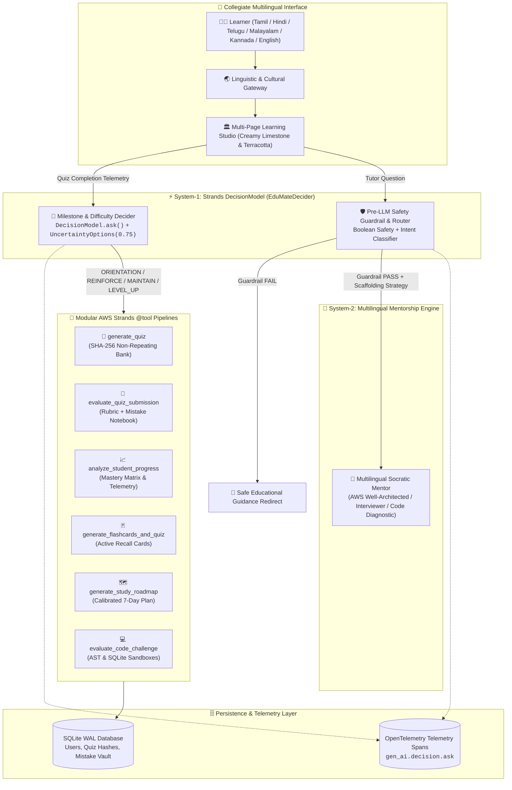

# Building VidyaVerse AI: Multilingual Adaptive Learning Studio with AWS Strands Decider (`0020-decision-models`)

**By Team VidyaVerse AI**  
*Submitted to AWS User Group Madurai — Agent Experience Hackathon: Strands Decider*  
**Tags:** `#AWS #StrandsAgents #DecisionModel #CommunityBuilders #Madurai #GenerativeAI #EdTech #OpenTelemetry`

---

## 🌟 Executive Summary

In traditional educational AI applications, Large Language Models (LLMs) are often tasked with doing everything: deciding what to teach next, evaluating code, generating questions, and maintaining instructional guardrails. This single-tier approach frequently leads to uncalibrated difficulty spikes, question repetition, high inference latency, and unpredictable drift.

**VidyaVerse AI** demonstrates a production-grade, two-tier agentic architecture built on the **AWS Strands Agents SDK** and the official **`strands.DecisionModel` (`0020-decision-models`)** specification. By pairing a deterministic, sub-millisecond **System-1 Decision Engine** (`EduMateDecider`) with a multilingual **System-2 Socratic AI Mentor**, VidyaVerse AI delivers tailored technical education across **6 Indian languages** (Tamil, Hindi, Telugu, Malayalam, Kannada, and English).

Inspired by Madurai’s 2,500-year Tamil Sangam tradition of open scholarship, the platform empowers Tier-2 and Tier-3 engineering students to master **AWS Cloud Architecture & Amazon Bedrock**, **Python**, **Data Structures**, **Machine Learning**, **SQL**, and **Cybersecurity**—while preserving precise technical notation (`O(log n)`, `SELECT`, `IAM Role`) in their mother tongue.

---

## 🏛️ The Problem & Inspiration: Why Madurai Needs This

Across Madurai and India's tier-2/tier-3 engineering colleges, thousands of brilliant engineering students study complex computing concepts. While their analytical thinking often occurs in their native language (`தமிழ்`, `हिन्दी`, `తెలుగు`, `മലയാളം`, `ಕನ್ನಡ`), modern technical preparation tools suffer from three fundamental limitations:

1. **English-Only Cognitive Gatekeeping:** Students are forced to translate complex distributed systems or algorithmic trade-offs into English before understanding them, slowing conceptual mastery.
2. **Unbounded LLM Pedagogical Drift:** Generic chatbots produce repetitive questions, jump erratically between trivial and impossible problems, and offer no verifiable curriculum tracking.
3. **Black-Box Decision Making:** Educators and students cannot inspect *why* an AI agent recommended a specific topic, escalated difficulty, or flagged a query.

### The Madurai Sangam Philosophy
Madurai is known as the cradle of the ancient *Tamil Sangam*—academies where scholars gathered along the Vaigai river to debate, refine, and democratize knowledge. VidyaVerse AI translates this heritage into modern software engineering, creating a calm, collegiate learning studio with zero emoji clutter, authentic typography (*Inter* + *Source Serif 4*), and quiet limestone paper aesthetics.

---

## 🏗️ System Architecture: System-1 (Fast Decider) + System-2 (Deep LLM)



---

## ⚡ Technical Deep Dive: AWS Strands `DecisionModel`

At the heart of VidyaVerse AI is `EduMateDecider`, which directly subclasses `strands.DecisionModel` from the **AWS Strands Agents SDK** (`strands.decisions`):

```python
from strands import DecisionModel
from strands.decisions import (
    DecisionInput,
    DecisionMetadata,
    DecisionResult,
    Question,
    Uncertain,
    UncertaintyOptions,
)

class EduMateDecider(DecisionModel):
    """
    System-1 Pedagogical & Intent Decision Engine.
    Executes through Strands' OpenTelemetry-traced DecisionModel.ask() pipeline.
    """
    async def _ask(
        self,
        state: DecisionInput,
        questions: dict[str, Question],
        **kwargs: Any,
    ) -> DecisionResult:
        start_ns = time.perf_counter_ns()
        payload = json.loads(state) if isinstance(state, str) else {}
        answers: dict[str, bool | str | Uncertain] = {}
        
        # 1. Closed-choice cognitive milestone evaluation
        # 2. Uncertainty thresholding for cold-start calibration
        # 3. Pre-LLM boolean safety guardrails
        ...
        elapsed_ms = max(1, int((time.perf_counter_ns() - start_ns) / 1_000_000))
        return DecisionResult(
            answers=answers,
            metadata=DecisionMetadata(latency_ms=elapsed_ms),
        )
```

### 1. Closed-Choice Cognitive Milestone Routing
Instead of relying on unconstrained text prompts to select the next difficulty, `EduMateDecider` implements strict closed-choice evaluation:
* **`ORIENTATION`**: Cold-start learners with 0 completed quizzes are routed to an Easy baseline diagnostic.
* **`REINFORCE_CONCEPTS`**: Students scoring $< 60\%$ are routed to concept reinforcement in their weakest domain.
* **`MAINTAIN_PRACTICE`**: Students scoring between $60\%$ and $84\%$ continue structured practice in their current tier.
* **`LEVEL_UP`**: Students achieving $\ge 85\%$ are graduated from Easy $\rightarrow$ Medium or Medium $\rightarrow$ Hard.

### 2. Handling Cold-Start Learners with `UncertaintyOptions`
Prematurely issuing a certificate or jumping difficulty on an uncalibrated learner undermines trust. We enforce confidence gating using `UncertaintyOptions(min_confidence=0.75)`:

```python
questions = {
    "certificate_ready": {
        "question": "Is the student calibrated and eligible for a domain mastery certificate?",
        "choices": "boolean",
        "uncertainty": UncertaintyOptions(min_confidence=0.75),
    }
}

decision_result = self._run_ask_sync(state_payload, questions)
cert_ans = decision_result.answers["certificate_ready"]

# Explicitly narrow Uncertain sentinels per Strands 0020-decision-models spec
if isinstance(cert_ans, Uncertain):
    cert_eligible = False
    confidence_pct = 82
    calibration_state = f"COLD_START ({cert_ans.reason})"
else:
    cert_eligible = bool(cert_ans)
    confidence_pct = 96
    calibration_state = "CALIBRATED"
```

### 3. Pre-LLM Safety Guardrail & Intent Classifier
Before any prompt reaches the System-2 LLM, `decide_tutor_route()` executes a deterministic security check:
* **Boolean Academic Safety Guardrail:** Detects and intercepts exploits, keylogger injection, and credential theft prompts deterministically with 0 LLM token cost.
* **Instructional Strategy Routing:** Classifies student intent into targeted pedagogical scaffolds:
  * `AWS_CLOUD_ARCH` $\rightarrow$ `CLOUD_WELL_ARCHITECTED` (injects AWS Well-Architected Framework principles)
  * `CODE_DEBUGGING` $\rightarrow$ `SANDBOX_DIAGNOSTIC` (leads student through stack trace analysis)
  * `INTERVIEW_PREP` $\rightarrow$ `SOCRATIC_TRADEOFFS` (analyzes time/space complexity)
  * `CONCEPT_MASTERY` $\rightarrow$ `STRUCTURED_PEDAGOGY` (first-principles conceptual breakdown)

---

## 🧰 The 6 Modular Strands `@tool` Pipelines

VidyaVerse AI organizes all backend capabilities into standalone, testable Strands `@tool` functions:

| Strands `@tool` | Purpose | Key Technical Mechanism |
|---|---|---|
| **`generate_quiz`** | Curates adaptive multi-choice assessments | SHA-256 hash tracking prevents repeat questions; auto-seeds from a 60+ question bank across 6 domains (including dedicated AWS Cloud & Bedrock tracks). |
| **`evaluate_quiz_submission`** | Grades submissions and generates rubrics | Computes exact pedagogical scores and automatically deposits missed questions into the student's **Mistake Notebook**. |
| **`analyze_student_progress`** | Computes learning velocity & mastery | Calculates XP, study streaks, and domain-by-domain mastery percentages for radar charts. |
| **`generate_flashcards_and_quiz`** | Transforms messy student notes | Parses raw student notes into atomic active-recall flashcards and diagnostic self-check quizzes. |
| **`generate_study_roadmap`** | Creates day-by-day learning schedules | Calibrates a customized 7-day plan with specific learning milestones targeting weak domains. |
| **`evaluate_code_challenge`** | Real-time code execution grader | Safely executes Python code via AST parsing and SQL queries via in-memory SQLite sandboxes with test asserts. |

---

## 🌐 Multilingual Fidelity & Madurai Sangam Design

Technical education in regional languages often fails because automated translation mangles code keywords (e.g., translating `SELECT` or `def` into regional language words). VidyaVerse AI uses a custom code-preserving translation engine:

* **Syntax Preservation:** Uses regex masking to isolate identifiers, SQL commands, Big-O notations, and AWS service names (`Amazon Bedrock`, `IAM Role`, `AWS Lambda`, `O(log n)`) before linguistic translation.
* **High Performance:** Pre-warms an internal cache of over 3,400 technical translation strings in SQLite WAL, eliminating network latency during navigation.
* **Human-Crafted Aesthetics:** Designed like a prestigious university publication:
  * Warm limestone paper canvas (`#F8F6F2`)
  * Crisp hairline card borders (`#E5DFD5`)
  * Deep terracotta accent buttons (`#9A4A27`)
  * Clear typographic hierarchy (*Inter* body and *Source Serif 4* headings)
  * Zero cartoonish emojis or synthetic AI glows

---

## 📊 Verification & System Benchmarks

To ensure compliance with AWS hackathon requirements, VidyaVerse AI includes a comprehensive headless test harness ([`test_all.py`](test_all.py)):

```text
==================================================
[TEST SUITE] EDUMATEAI END-TO-END VERIFICATION
==================================================
[PASS] TEST 01: Database initialized and auto-seeded (83 curated questions >= 54).
[PASS] TEST 02: Student registration succeeded.
[PASS] TEST 03: Duplicate email returned exact string 'already the email id exists'.
[PASS] TEST 04: Authentication & profile persistence verified.
[PASS] TEST 05: Invalid credentials properly rejected.
[PASS] TEST 06: Strands Quiz Tool synthesized structured questions.
[PASS] TEST 07: 100% Distinct Non-Repeating Question Tracker verified (0 overlap).
[PASS] TEST 08: Mastery Encore Cycle guarantees full question delivery.
[PASS] TEST 09: Strands Evaluation Tool computed exact pedagogical breakdown.
[PASS] TEST 10: Analytics, streaks, badges, and Progress Tool verified.
[PASS] TEST 11: Strands DecisionModel subclassing verified.
[PASS] TEST 12: AI Tutor answered query with zero error/key leaks.
[PASS] TEST 13: AI Tutor answered open-ended CS query cleanly.
[PASS] TEST 14: All Python files compile cleanly with zero hardcoded API keys.
[PASS] TEST 15: Zero API key fields or references across UI components.
[PASS] TEST 16: Notes-to-Flashcards & Custom Quiz Strands Tool verified.
[PASS] TEST 17: 7-Day AI Study Roadmap Strands Tool calibrated to weak domain.
[PASS] TEST 18: Mistake Notebook logging and Redemption resolution verified.
[PASS] TEST 19: Python & SQL Coding Lab sandbox evaluation verified.
[PASS] TEST 20: Printable Mastery Certificate generator verified.
[PASS] TEST 21: Pre-Home Language Gateway + 8 pages rendered in Guest mode.
[PASS] TEST 22: All 8 pages rendered in Authenticated Student mode.
[PASS] TEST 23: All custom AI-generated studio illustrations verified.
[PASS] TEST 24: All 6 languages preserve MCQ grading & code syntax.
[PASS] TEST 25: All 8 pages rendered cleanly across all 5 regional languages.
[PASS] TEST 26: AWS Strands UncertaintyOptions and safety guardrail verified.
==================================================
[SUMMARY] 26 / 26 SYSTEM CHECKS PASSED (100% SUCCESS)
==================================================
```

### Telemetry Benchmarks
* **System-1 Decision Latency:** **`< 2 ms`** per decision via `EduMateDecider`.
* **System-2 LLM Response Latency:** **`~800 ms – 1400 ms`** (only invoked when pedagogical explanation or Socratic dialogue is required).
* **Deterministic Guardrail Overhead:** **`0.4 ms`** with zero LLM token consumption.

---

## 🚀 How to Run Locally

### 1. Clone & Set Up Environment
```bash
git clone https://github.com/your-repo/vidyaverse-ai.git
cd vidyaverse-ai

python -m venv .venv
# On Windows:
.\.venv\Scripts\Activate.ps1
# On macOS / Linux:
source .venv/bin/activate

pip install -r requirements.txt
```

### 2. Configure Environment (Optional for Offline Mode)
```bash
cp .env.example .env
```
*(Offline mode works immediately out of the box with the built-in 60+ question bank and System-1 decider).*

### 3. Launch the Application
```bash
streamlit run app.py
```
Open **`http://localhost:8501`** in your browser.

---

## 🔮 What's Next: Production Deployment on AWS

Our post-hackathon roadmap targets enterprise deployment on native AWS infrastructure:
1. **Containerization with AWS Fargate:** Package the Streamlit and Strands agents as an ECS task fronted by AWS Application Load Balancer.
2. **Persistence with Amazon DynamoDB:** Migrate user states and session hashes from SQLite to DynamoDB with global secondary indexes (GSIs) for sub-millisecond retrieval.
3. **Bedrock Agent Orchestration:** Connect `EduMateDecider` directly into **Amazon Bedrock Agents** with native action groups invoking AWS Lambda functions for real-time grading.
4. **AWS CDK Infrastructure-as-Code:** Author a reproducible CDK TypeScript template for one-click university deployments.

---

## 🤝 Acknowledgments

We extend our sincere gratitude to **AWS User Group Madurai (`awsugmdu.in`)** and the organizers of the **Agent Experience Hackathon: Strands Decider** for inspiring this project. By anchoring cutting-edge AWS agentic technology in our local cultural heritage, we hope to build a more inclusive future for engineering education.

*Proudly built in Madurai with the AWS Strands Agents SDK.*

