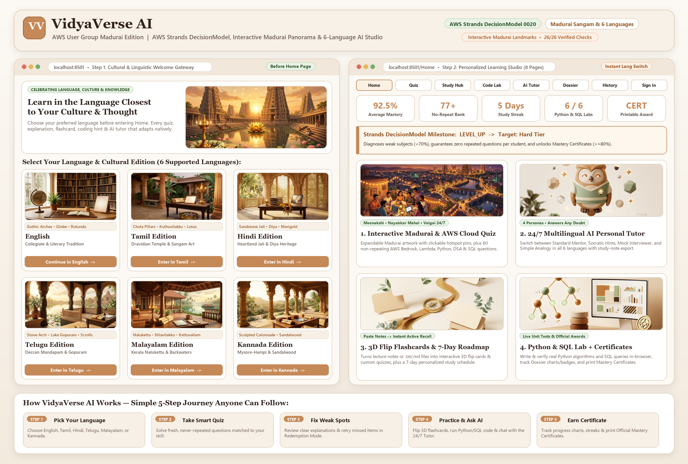

# 🎓 VidyaVerse AI — Easy Plain-Language Guide (`AWS User Group Madurai Edition`)

> **What is VidyaVerse AI?**  
> **VidyaVerse AI** (*Vidya* = Knowledge + *Verse* = Learning Universe) is an adaptive technical learning platform engineered for **AWS User Group Madurai — Agent Experience Hackathon: Strands Decider**. Learners can take intelligent non-repeating quizzes (including **AWS Cloud & Amazon Bedrock**), study active-recall cards from their notes, practice live Python & SQL coding, chat with a safety-guardrailed Socratic AI tutor, and earn verified mastery certificates — **natively in Tamil (`தமிழ்`), Hindi (`हिन्दी`), Telugu (`తెలుగు`), Malayalam (`മലയാളം`), Kannada (`ಕನ್ನಡ`), or English.**



## 🏛️ Human-Crafted, Collegiate UI/UX
- **Quiet Academic Typography & Warm Limestone Palette:** Designed with an authentic, human-made aesthetic — featuring *Inter* and *Source Serif 4* typography, warm limestone paper (`#F8F6F2`), crisp hairline card borders (`#E5DFD5`), deep terracotta interactive accents (`#9A4A27`), and a geometric brand mark. No synthetic neon glows, no floating emoji spam, and no generic AI card templates.
- **Madurai Sangam Heritage:** Honors Madurai's 2,500-year legacy of open scholarship and the ancient Sangam academies with curated cultural landscape portraits across Meenakshi Amman, Thirumalai Nayakkar Mahal, and the Vaigai tech community.

## 🚀 How It Works in 5 Clear Steps
1. **Choose Your Language:** Select **English, Tamil, Hindi, Telugu, Malayalam, or Kannada** on the cultural gateway. Technical code blocks and notation (`O(log n)`, `SELECT`, `IAM Role`) remain pristine.
2. **Interactive 3-Step Assessment Switcher:**
   - **Step 1 — Configure Assessment:** Pick from 6 domains (**AWS Cloud & Bedrock**, **Python**, **Data Structures**, **Machine Learning**, **SQL**, or **Cybersecurity**), select difficulty, and choose question count.
   - **Step 2 — Solve Questions:** Work through cleanly typeset, non-repeating questions with immediate verification.
   - **Step 3 — Results & Certificate:** Review your pedagogical rubric score, confidence telemetry, and download your printable SVG-framed certificate.
3. **Clear Past Mistakes:** Missed questions are saved to your **Mistake Notebook** so you can re-attempt and clear them in **Redemption Mode**.
4. **Study Cards, Live Code & Socratic Tutor:** Convert class notes into active-recall flashcards, follow a calibrated **7-Day Study Plan**, run real **Python & SQL** code in the browser sandbox, and discuss problems with the **Guardrailed AI Tutor** (Mentor, Socratic hints, Mock Interviewer, or Conceptual Analogy).
5. **Track Progress & Earn Certificates:** Monitor streaks, domain mastery matrices, and weak-topic alerts in your **Student Dossier**, export **CSV transcripts**, and print **Official Certificates of Mastery** for scores $\ge 80\%$.

## 💻 Manual Localhost Launch
To launch VidyaVerse AI manually on your local computer:

```powershell
# Open terminal in the project directory:
cd "e:\strand hackthon\EduMateAI"

# Activate the Python virtual environment:
.\.venv\Scripts\Activate.ps1

# Start the application:
streamlit run app.py
```
*The app will open automatically in your browser at `http://localhost:8501`.*
