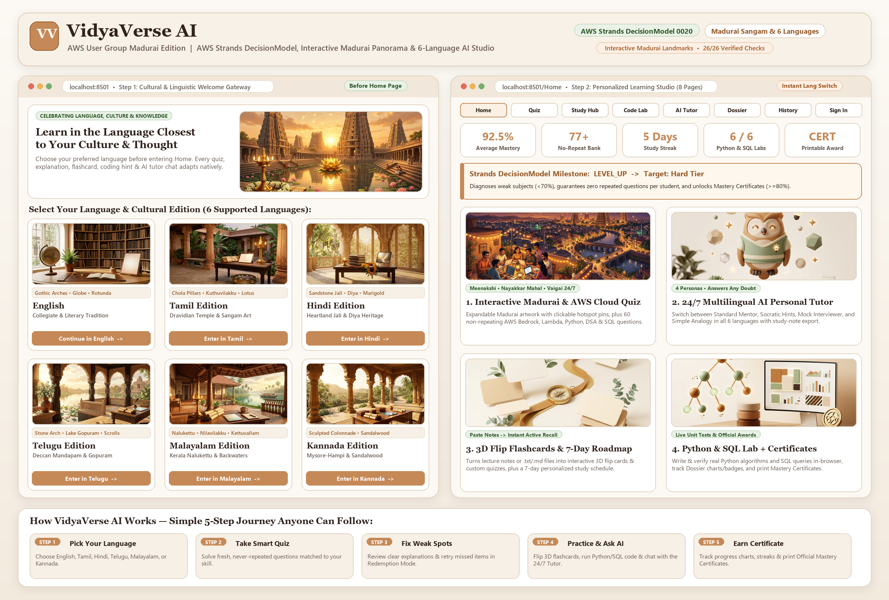
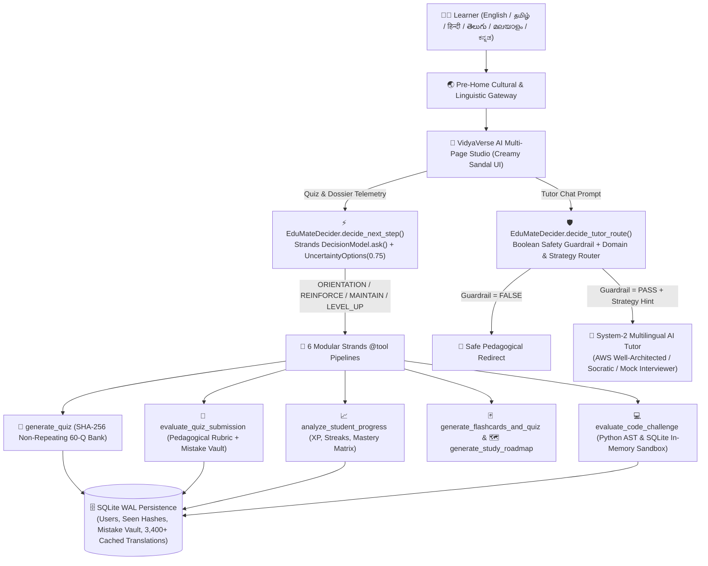

# 🎓 VidyaVerse AI — Multilingual Adaptive AI Learning Studio
### 🏛️ Built for **AWS User Group Madurai** • *Agent Experience Hackathon: Strands Decider*

[](https://github.com/strands-agents/sdk-python)
[](AWS_BUILD_CENTER_BLOG.md)
[](#2--6-language-cultural-onboarding--madurai-sangam-edition)
[](#-automated-verification-suite)

> **VidyaVerse AI** is an agentic engineering & cloud-learning platform powered by the **AWS Strands Agents SDK** and **`strands.DecisionModel` (`0020-decision-models`)**. Inspired by Madurai's 2,500-year **Tamil Sangam** heritage of open scholarship, VidyaVerse AI empowers learners across Tier-2/Tier-3 colleges and beyond to master **AWS Cloud & Amazon Bedrock**, **Python**, **AI/ML**, **Data Structures**, **SQL**, and **Cybersecurity** natively in **Tamil, Hindi, Telugu, Malayalam, Kannada, or English**.



---

## 🎯 Problem Statement & Community Impact (Why Madurai & Beyond Need This)

Millions of talented engineering students across Madurai, Tamil Nadu, and pan-Indian regional campuses think deeply in their mother tongue (`தமிழ்`, `हिन्दी`, `తెలుగు`, `മലയാളം`, `ಕನ್ನಡ`), yet technical preparation platforms suffer from three major gaps:
1. **Unbounded LLM Drift Instead of Deterministic Pedagogy**: Generic chatbots hallucinate difficulty jumps, repeat the same quiz questions, and lack calibrated confidence thresholds.
2. **English-Only Gatekeeping**: Students rarely get rigorous AWS Cloud, Algorithms, or SQL assessments—and Socratic mentorship—in their native script while preserving exact code syntax (`O(log n)`, `SELECT`, `IAM Role`).
3. **Opaque Agent Decisions**: Learners and educators cannot see *why* an AI agent chose a specific difficulty tier, routing strategy, or safety guardrail action.

**VidyaVerse AI** solves all three by pairing a fast, transparent **System-1 `Strands DecisionModel`** with **6 modular Strands `@tool` pipelines**, a **60-question SHA-256 non-repeating curriculum bank** (including dedicated **AWS Cloud & Amazon Bedrock** assessments), and a **6-language Cultural Heritage Studio**.

---

## ⚡ How AWS `Strands DecisionModel` (`0020-decision-models`) Powers VidyaVerse AI

Rather than using slow, uncalibrated LLM prompts for control flow, `EduMateDecider(DecisionModel)` in [`agent.py`](agent.py) implements the official Strands Decision Models specification (`strands.decisions`):

| Strands Decider Primitive | Implementation in `agent.py` | Live Agent UX Impact |
|---|---|---|
| **`DecisionModel` Subclass & OTel `self.ask()`** | `EduMateDecider` subclasses `strands.DecisionModel` and executes through `DecisionModel.ask()`, emitting OpenTelemetry `gen_ai.decision.ask` spans and `DecisionMetadata(latency_ms=...)`. | Sub-millisecond System-1 decision latency displayed live inside quiz, dashboard, and chat telemetry pills. |
| **Closed-Choice Milestone Routing** | Evaluates `pedagogical_milestone` (`ORIENTATION`, `REINFORCE_CONCEPTS`, `MAINTAIN_PRACTICE`, `LEVEL_UP`) and `next_difficulty` (`Easy`, `Medium`, `Hard`). | Dynamically prescribes the exact next domain and difficulty after every quiz round. |
| **`UncertaintyOptions` & `Uncertain` Narrowing** | Applies `UncertaintyOptions(min_confidence=0.75)` on `certificate_ready` and `min_confidence=0.70` on `query_domain`, explicitly narrowing `isinstance(ans, Uncertain)`. | Prevents premature mastery certification on cold-start learners (`COLD_START` vs `CALIBRATED`) and safely falls back on vague queries. |
| **Pre-LLM Intent Router & Safety Guardrail** | `decide_tutor_route()` evaluates a boolean `academic_safety_guardrail` + closed-choice `query_domain` (`AWS_CLOUD_ARCH`, `CODE_DEBUGGING`, `INTERVIEW_PREP`, `CONCEPT_MASTERY`) before invoking System-2 generation. | Blocks destructive exploit/malware prompts deterministically and injects **AWS Well-Architected** or **Sandbox Diagnostic** scaffolding into the tutor model. |

### System-1 + System-2 Agentic Architecture



---

## 🌟 Key Platform Capabilities

### 1. 🪷 Madurai Architectural & Sangam Heritage UI/UX + 6-Language Localization
- **Unified Madurai Design Language (`components/navbar.py`)**: Every page is woven in a **Madurai Malli Ivory & Sungudi micro-dot** canvas crowned with **Gopuram Zari & Temple Kumkum** border accents, a custom **Potramarai (Golden Lotus) SVG Crest**, ornamental **Kolam-Lotus dividers (`✦ 🪷 ✦`)**, and interactive zoom-on-hover Madurai artworks (**Meenakshi Gopurams & Potramarai Kulam**, **Thirumalai Nayakkar Mahal & Olai Chuvadi**, and **Thoonga Nagaram 24/7 Vaigai Builders**) with slide-up cultural story overlays.
- **6 Cultural Editions**: Greets learners before entering Home in **Tamil (`தமிழ்`), Hindi (`हिन्दी`), Telugu (`తెలుగు`), Malayalam (`മലയാളം`), Kannada (`ಕನ್ನಡ`), or English**, translating **100% of the platform**—navigation, curriculum cards, quiz questions & options (preserving `A./B./C./D.` grading keys and inline `` `code` `` spans), rubrics, printable HTML certificates, 3D flashcards, 7-day study plans, coding hints, and live AI Tutor responses.

### 2. ☁️ AWS Cloud & Amazon Bedrock Curriculum + Non-Repeating Quiz Studio
- **60 Curated Engineering Questions across 6 Domains**:
  1. **Python Programming** (`GIL`, `MRO`, mutability, generators)
  2. **Artificial Intelligence & ML** (`Transformers`, `RAG`, `LoRA`, `GANs`)
  3. **Data Structures & Algorithms** (`QuickSort`, `Dijkstra`, `LRU Cache`, `Union-Find`)
  4. **Web Development & Cloud (AWS Track)** (`Amazon Bedrock` Knowledge Bases & Guardrails, `AWS Lambda` warm execution reuse, `Amazon S3` 11-nines durability, `AWS IAM` Least Privilege Roles, `Amazon VPC` Private Subnets + `NAT Gateway`, `Amazon DynamoDB` hot-partition mitigation, `Docker`, `CAP`)
  5. **Database Systems & SQL** (`3NF`, `B+ Trees`, `MVCC`, `WAL`)
  6. **Cybersecurity & Networks** (`TLS 1.3 PFS`, `SSRF`, `OAuth2 PKCE`, `CSRF/XSS`)
- **Zero-Repeat SHA-256 Guarantee (`student_seen_questions`)**, **45s/question Timed Exam Mode**, **Spaced-Repetition Mistake Redemption Vault**, and **Printable Multilingual Mastery Certificates (`>= 80%`)**.

### 3. 💻 Live Python & SQL Coding Lab + 🃏 3D Study Studio + 💬 24/7 AI Tutor
- **Interactive Coding Lab**: Solve 6 real Python & SQL challenges verified instantaneously against unit tests and an in-memory relational dataset.
- **3D Study Studio**: Turn raw lecture notes into interactive CSS 3D click-to-flip flashcards + custom self-check quizzes, or generate a **7-Day Personalized Study Roadmap** calibrated to weak domains.
- **System-1 Guardrailed AI Tutor**: 4 teaching personas (*Standard Mentor*, *Socratic Hints*, *Mock Interviewer*, *Simple Analogy*), one-click **AWS Bedrock & Lambda** starter, live Strands Decider trace badges, and Markdown study-note export.

---

## ☁️ AWS Production Reference Architecture (Cloud Deployment Blueprint)

VidyaVerse AI is architected for frictionless deployment onto AWS managed services:
- **Compute & Streaming UI**: Containerize via **AWS App Runner** or **Amazon ECS on AWS Fargate** behind an **Application Load Balancer (`ALB`)** + **AWS WAF**.
- **Foundation Models & Guardrails**: Plug Strands `Agent` directly into **Amazon Bedrock** (`Claude 3.7 Sonnet` / `Amazon Nova Pro`) paired with **Bedrock Knowledge Bases** (curriculum RAG) and **Bedrock Guardrails**.
- **System-1 Strands Decider**: Run `EduMateDecider(DecisionModel)` in-process or via **AWS Lambda** (`SnapStart`) for sub-10ms routing and confidence gating (`UncertaintyOptions`) with traces exported to **AWS X-Ray / CloudWatch** via Strands OpenTelemetry.
- **State & Static Assets**: Migrate SQLite tables (`users`, `quiz_history`, `student_seen_questions`, `translation_cache`) 1-to-1 to **Amazon DynamoDB** (`PK: email`, `SK: record_id`), store artwork/certificates on **Amazon S3 + CloudFront**, and inject credentials exclusively via **IAM Roles** and **AWS Secrets Manager**.

---

## 📁 Clean Repository Structure

```text
VidyaVerseAI/
├── app.py                        # 🏠 Pre-Home Language Gateway Router & Home Studio
├── agent.py                      # ⚡ AWS Strands Agent & EduMateDecider(DecisionModel)
├── agent_chat.py                 # 💬 System-2 Multilingual AI Tutor (Strategy-Conditioned)
├── OVERVIEW_GUIDE.md             # 📖 Plain-Language Visual Guide for Students & Judges
├── assets/                       # 🖼️ 14 Custom AI Cultural, Madurai & Studio Illustrations + Overview Poster
├── components/
│   ├── __init__.py
│   ├── language_gateway.py       # 🌏 6-Language Cultural Onboarding Gateway (Madurai Sangam Edition)
│   ├── i18n.py                   # 🌐 Localization Engine + WAL SQLite Cache + Code/MCQ Preservation
│   ├── navbar.py                 # 🪷 Madurai Malli/Sungudi/Zari UI Theme, Golden Lotus Crest & Hover Art
│   └── certificate.py            # 🏅 Printable Multilingual Mastery Certificate Generator
├── pages/
│   ├── 1_Adaptive_Quiz.py        # ✍️ Adaptive Quiz, Timed Mode, Decider Telemetry & Redemption
│   ├── 2_Student_Dashboard.py    # 📊 Individual Student Dossier, Mastery Charts & Badges
│   ├── 3_Authentication.py       # 🔐 Salted SHA-256 Sign In & Registration
│   ├── 4_Learning_History.py     # 📜 Filterable Study Transcripts & UTF-8-SIG CSV Export
│   ├── 5_AI_Tutor_Chat.py        # 💬 24/7 Guardrailed AI Tutor (4 Personas + Decider Trace)
│   ├── 6_Study_Studio.py         # 🃏 Notes-to-3D-Flashcards & 7-Day AI Study Roadmap
│   └── 7_Coding_Lab.py           # 💻 Interactive Python & SQL Coding Sandbox
├── database/
│   ├── __init__.py
│   ├── db_manager.py             # 🗄️ Auto-Initializing SQLite Persistence & Analytics Engine
│   └── seed_questions.py         # 📚 60 Curated Questions (Including AWS Cloud & Bedrock Track)
├── tools/
│   ├── __init__.py
│   ├── quiz_tool.py              # 🎲 Strands @tool: Non-Repeating Quiz Generator
│   ├── evaluation_tool.py        # 📝 Strands @tool: Pedagogical Rubric Evaluator
│   ├── progress_tool.py          # 📈 Strands @tool: Student Mastery & Weak-Domain Analyzer
│   ├── study_tools.py            # 🗺️ Strands @tool: 3D Flashcards & 7-Day Roadmap Builder
│   └── coding_tool.py            # 💻 Strands @tool: Sandboxed Python & SQL Challenge Grader
├── .streamlit/config.toml        # ⚙️ Creamy Sandal Theme & Multi-Page Configuration
├── .env.example                  # 🔑 Clean Environment Variable Template (Zero Hardcoded Keys)
├── .gitignore                    # 🛡️ Excludes .env, .venv/, database/student.db & __pycache__/
├── requirements.txt              # 📦 Pinned Python Dependencies (strands-agents, streamlit, etc.)
├── start.bat                     # ▶️ One-Click Windows Localhost Launcher
└── test_all.py                   # ✅ 26-Check End-to-End Automated Verification Suite
```

---

## 🚀 Quickstart (Run Locally in 60 Seconds)

### 1. Clone & Create Virtual Environment
```bash
git clone <your-github-repo-url>
cd VidyaVerseAI
python -m venv .venv
# Windows:
.venv\Scripts\activate
# macOS / Linux:
source .venv/bin/activate
```

### 2. Install Dependencies
```bash
pip install -r requirements.txt
```

### 3. Configure Environment Variables (Optional for Offline Mode, Recommended for Live LLM)
```bash
cp .env.example .env
```
Add your model credential inside `.env` (never committed to Git). All core quizzes, Strands `DecisionModel` routing, Python/SQL labs, flashcards, 7-day roadmaps, and built-in AWS/CS tutor explanations also feature resilient offline fallbacks so judges can test immediately out of the box!

### 4. Launch VidyaVerse AI
```bash
streamlit run app.py
```
*(On Windows, you can also double-click or run `.\start.bat`)*

---

## ✅ Automated Verification Suite (`26 / 26` Checks)

Run the full headless test suite (verifying `EduMateDecider(DecisionModel)` subclassing, `UncertaintyOptions` cold-start `Uncertain` narrowing, pre-LLM tutor routing & boolean safety guardrails, 60-question auto-seeding, non-repeating SHA-256 guarantees, zero secret/key exposure across code & UI, and headless rendering of all 8 pages across all 6 languages):

```bash
python test_all.py
```

---

## 🛡️ Security & Engineering Compliance
- **Zero Secret Leakage**: Credentials are loaded strictly from `.env` via `python-dotenv`; `.gitignore` excludes `.env` and runtime databases; zero key inputs or references appear anywhere in UI components.
- **Deterministic & Auditable**: Salted `SHA-256` authentication, case-insensitive duplicate email protection, and explicit `Strands DecisionModel` confidence/latency telemetry on every pedagogical decision.
